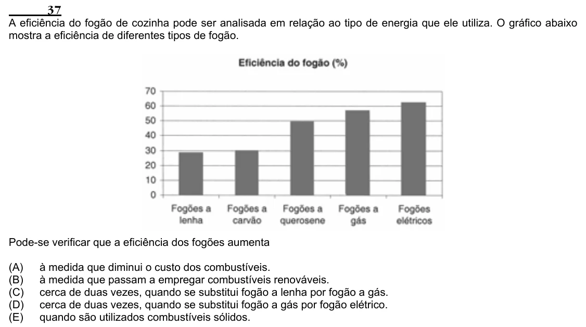

Texto extraído (pode conter ruído)

37  
A eficiência do fogão de cozinha pode ser analisada em relação ao tipo de energia que ele utiliza. O gráfico abaixo  
mostra a eficiência de diferentes tipos de fogão.  
Pode-se verificar que a eficiência dos fogões aumenta  
(A)  
à medida que diminui o custo dos combustíveis.  
(B)  
à medida que passam a empregar combustíveis renováveis.  
(C)  
cerca de duas vezes, quando se substitui fogão a lenha por fogão a gás.  
(D)  
cerca de duas vezes, quando se substitui fogão a gás por fogão elétrico.  
(E)  
quando são utilizados combustíveis sólidos.

