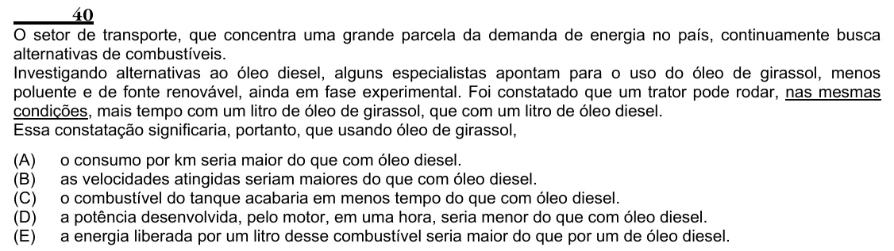

Texto extraído (pode conter ruído)

40  
O setor de transporte, que concentra uma grande parcela da demanda de energia no país, continuamente busca  
alternativas de combustíveis.  
Investigando alternativas ao óleo diesel, alguns especialistas apontam para o uso do óleo de girassol, menos  
poluente e de fonte renovável, ainda em fase experimental. Foi constatado que um trator pode rodar, nas mesmas  
condições, mais tempo com um litro de óleo de girassol, que com um litro de óleo diesel.  
Essa constatação significaria, portanto, que usando óleo de girassol,  
(A)  
o consumo por km seria maior do que com óleo diesel.  
(B)  
as velocidades atingidas seriam maiores do que com óleo diesel.  
(C)  
o combustível do tanque acabaria em menos tempo do que com óleo diesel.  
(D)  
a potência desenvolvida, pelo motor, em uma hora, seria menor do que com óleo diesel.  
(E)  
a energia liberada por um litro desse combustível seria maior do que por um de óleo diesel.

