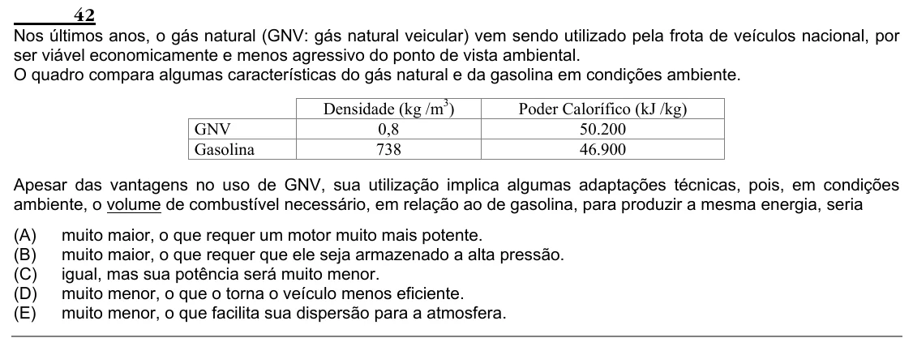

Texto extraído (pode conter ruído)

42  
Nos últimos anos, o gás natural (GNV: gás natural veicular) vem sendo utilizado pela frota de veículos nacional, por  
ser viável economicamente e menos agressivo do ponto de vista ambiental.  
O quadro compara algumas características do gás natural e da gasolina em condições ambiente.  
Densidade (kg /m 3 )  
Poder Calorífico (kJ /kg)  
GNV  
0,8  
50.200  
Gasolina  
738  
46.900  
Apesar das vantagens no uso de GNV, sua utilização implica algumas adaptações técnicas, pois, em condições  
ambiente, o volume de combustível necessário, em relação ao de gasolina, para produzir a mesma energia, seria  
(A)  
muito maior, o que requer um motor muito mais potente.  
(B)  
muito maior, o que requer que ele seja armazenado a alta pressão.  
(C)  
igual, mas sua potência será muito menor.  
(D)  
muito menor, o que o torna o veículo menos eficiente.  
(E)  
muito menor, o que facilita sua dispersão para a atmosfera.

