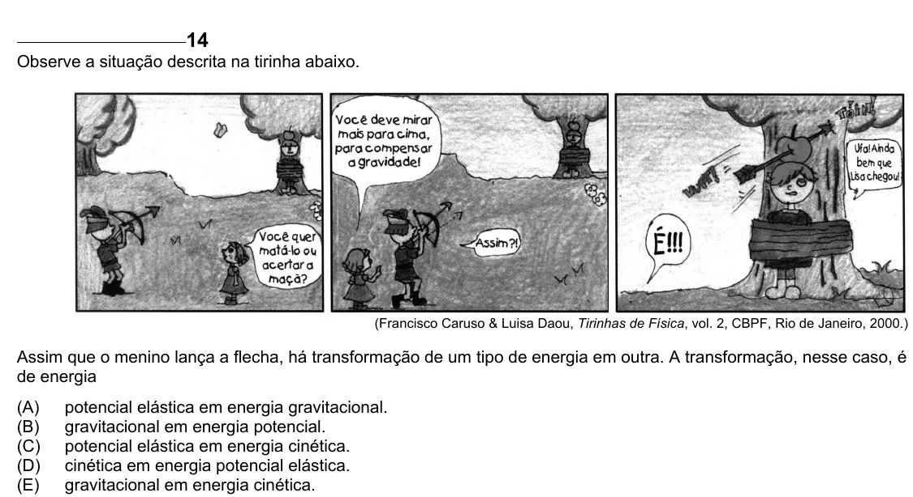

Texto extraído (pode conter ruído)

14  
Observe a situação descrita na tirinha abaixo.  
(Francisco Caruso & Luisa Daou, Tirinhas de Física, vol. 2, CBPF, Rio de Janeiro, 2000.)  
Assim que o menino lança a flecha, há transformação de um tipo de energia em outra. A transformação, nesse caso, é  
de energia  
(A)  
potencial elástica em energia gravitacional.  
(B)  
gravitacional em energia potencial.  
(C)  
potencial elástica em energia cinética.  
(D)  
cinética em energia potencial elástica.  
(E)  
gravitacional em energia cinética.

