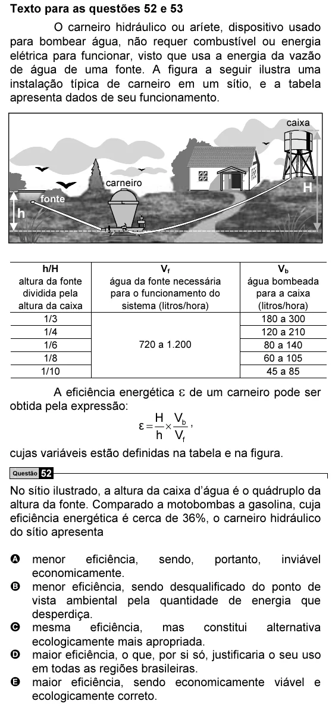

Texto extraído (pode conter ruído)

Texto para as questões 52 e 53  
O carneiro hidráulico ou aríete, dispositivo usado  
para bombear água, não requer combustível ou energia  
elétrica para funcionar, visto que usa a energia da vazão  
de água de uma fonte. A figura a seguir ilustra uma  
instalação típica de carneiro em um sítio, e a tabela  
apresenta dados de seu funcionamento.  
caixa  
carneiro  
H  
fonte  
h  
h/H  
V f  
V b  
altura da fonte  
água da fonte necessária  
água bombeada  
dividida pela  
para o funcionamento do  
para a caixa  
altura da caixa  
sistema (litros/hora)  
(litros/hora)  
1/3  
180 a 300  
1/4  
120 a 210  
1/6  
720 a 1.200  
80 a 140  
1/8  
60 a 105  
1/10  
45 a 85  
A eficiência energética ε de um carneiro pode ser  
obtida pela expressão:  
H V  
ε = × b ,  
h V f  
cujas variáveis estão definidas na tabela e na figura.  
Questão 52  
No sítio ilustrado, a altura da caixa d’água é o quádruplo da  
altura da fonte. Comparado a motobombas a gasolina, cuja  
eficiência energética é cerca de 36%, o carneiro hidráulico  
do sítio apresenta  
A menor  
eficiência,  
sendo,  
portanto,  
inviável  
economicamente.  
B menor eficiência, sendo desqualificado do ponto de  
vista ambiental pela quantidade de energia que  
desperdiça.  
C mesma  
eficiência,  
mas  
constitui  
alternativa  
ecologicamente mais apropriada.  
D maior eficiência, o que, por si só, justificaria o seu uso  
em todas as regiões brasileiras.  
E maior eficiência, sendo economicamente viável e  
ecologicamente correto.

