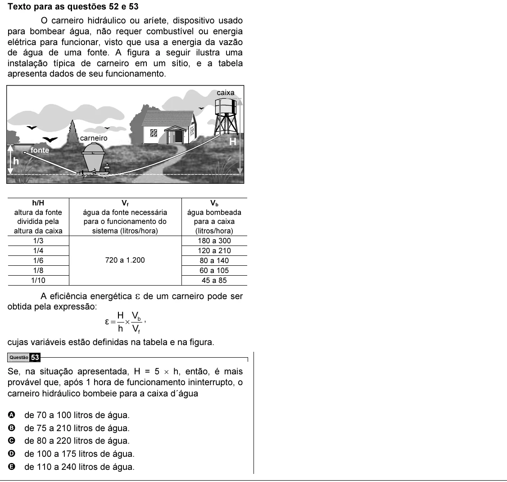

Texto extraído (pode conter ruído)

Texto para as questões 52 e 53  
O carneiro hidráulico ou aríete, dispositivo usado  
para bombear água, não requer combustível ou energia  
elétrica para funcionar, visto que usa a energia da vazão  
de água de uma fonte. A figura a seguir ilustra uma  
instalação típica de carneiro em um sítio, e a tabela  
apresenta dados de seu funcionamento.  
caixa  
carneiro  
H  
fonte  
h  
h/H  
V f  
V b  
altura da fonte  
água da fonte necessária  
água bombeada  
dividida pela  
para o funcionamento do  
para a caixa  
altura da caixa  
sistema (litros/hora)  
(litros/hora)  
1/3  
180 a 300  
1/4  
120 a 210  
1/6  
720 a 1.200  
80 a 140  
1/8  
60 a 105  
1/10  
45 a 85  
A eficiência energética ε de um carneiro pode ser  
obtida pela expressão:  
H V  
ε = × b ,  
h V f  
cujas variáveis estão definidas na tabela e na figura.  
Questão 53  
Se, na situação apresentada, H = 5 × h, então, é mais  
provável que, após 1 hora de funcionamento ininterrupto, o  
carneiro hidráulico bombeie para a caixa d´água  
A  
de 70 a 100 litros de água.  
B  
de 75 a 210 litros de água.  
C  
de 80 a 220 litros de água.  
D  
de 100 a 175 litros de água.  
E  
de 110 a 240 litros de água.

