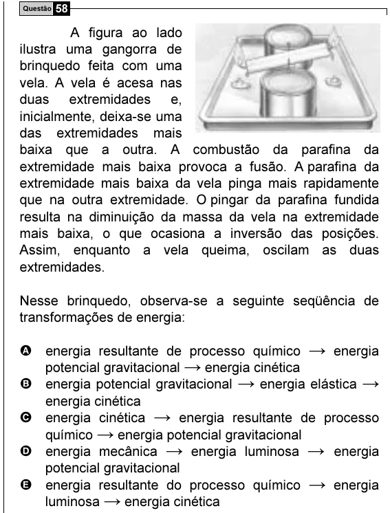

Texto extraído (pode conter ruído)

Questão 58  
A figura ao lado  
ilustra uma gangorra de  
brinquedo feita com uma  
vela. A vela é acesa nas  
duas extremidades e,  
inicialmente, deixa-se uma  
das extremidades mais  
baixa que a outra. A combustão da parafina da  
extremidade mais baixa provoca a fusão. A parafina da  
extremidade mais baixa da vela pinga mais rapidamente  
que na outra extremidade. O pingar da parafina fundida  
resulta na diminuição da massa da vela na extremidade  
mais baixa, o que ocasiona a inversão das posições.  
Assim, enquanto a vela queima, oscilam as duas  
extremidades.  
Nesse brinquedo, observa-se a seguinte seqüência de  
transformações de energia:  
A energia resultante de processo químico → energia  
potencial gravitacional → energia cinética  
B energia potencial gravitacional → energia elástica →  
energia cinética  
C energia cinética → energia resultante de processo  
químico → energia potencial gravitacional  
D energia mecânica → energia luminosa → energia  
potencial gravitacional  
E energia resultante do processo químico → energia  
luminosa → energia cinética

