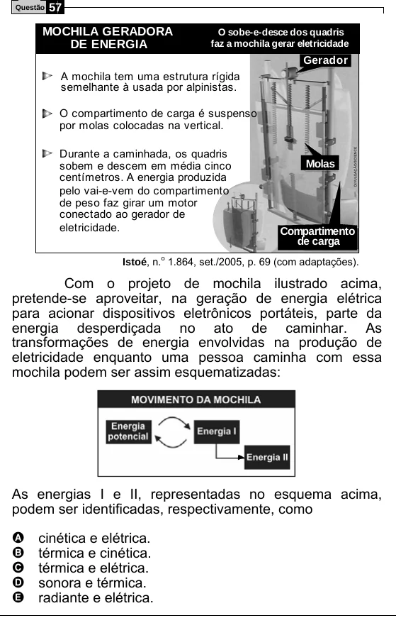

Texto extraído (pode conter ruído)

57  
Questão  
MOCHILA GERADORA  
O sobe-e-desce dos quadris  
DE ENERGIA  
faz a mochila gerar eletricidade  
Gerador  
A mochila tem uma estrutura rígida  
semelhante à usada por alpinistas.  
O compartimento de carga é suspenso  
por molas colocadas na vertical.  
Durante a caminhada, os quadris  
sobem e descem em média cinco  
Molas  
centímetros. A energia produzida  
pelo vai-e-vem do compartimento  
de peso faz girar um motor  
conectado ao gerador de  
eletricidade.  
Compartimento  
de carga  
Istoé, n. 1.864, set./2005, p. 69 (com adaptações).  
o  
Com o projeto de mochila ilustrado acima,  
pretende-se aproveitar, na geração de energia elétrica  
para acionar dispositivos eletrônicos portáteis, parte da  
energia desperdiçada no ato de caminhar. As  
transformações de energia envolvidas na produção de  
eletricidade enquanto uma pessoa caminha com essa  
mochila podem ser assim esquematizadas:  
As energias I e II, representadas no esquema acima,  
podem ser identificadas, respectivamente, como  
cinética e elétrica.  
A  
B  
térmica e cinética.  
C  
térmica e elétrica.  
sonora e térmica.  
D  
E  
radiante e elétrica.

