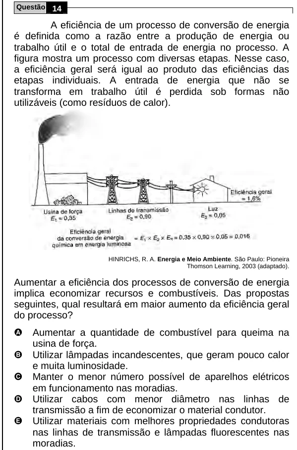

Texto extraído (pode conter ruído)

Questão 14  
A eficiência de um processo de conversão de energia  
é definida como a razão entre a produção de energia ou  
trabalho útil e o total de entrada de energia no processo. A  
figura mostra um processo com diversas etapas. Nesse caso,  
a eficiência geral será igual ao produto das eficiências das  
etapas individuais. A entrada de energia que não se  
transforma em trabalho útil é perdida sob formas não  
utilizáveis (como resíduos de calor).  
HINRICHS, R. A. Energia e Meio Ambiente. São Paulo: Pioneira  
Thomson Learning, 2003 (adaptado).  
Aumentar a eficiência dos processos de conversão de energia  
implica economizar recursos e combustíveis. Das propostas  
seguintes, qual resultará em maior aumento da eficiência geral  
do processo?  
A  
Aumentar a quantidade de combustível para queima na  
usina de força.  
B  
Utilizar lâmpadas incandescentes, que geram pouco calor  
e muita luminosidade.  
C  
Manter o menor número possível de aparelhos elétricos  
em funcionamento nas moradias.  
D  
Utilizar cabos com menor diâmetro nas linhas de  
transmissão a fim de economizar o material condutor.  
E  
Utilizar materiais com melhores propriedades condutoras  
nas linhas de transmissão e lâmpadas fluorescentes nas  
moradias.

