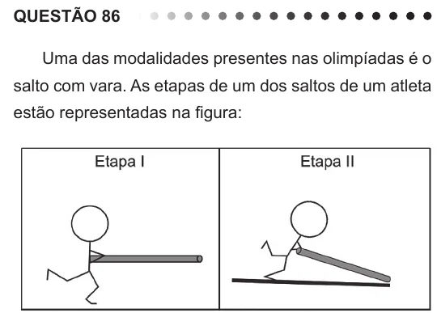

Texto extraído (pode conter ruído)

QUESTÃO 86  
Uma das modalidades presentes nas olimpíadas é o  
salto com vara. As etapas de um dos saltos de um atleta  
estão representadas na figura:  
Desprezando-se as forças dissipativas (resistência do ar  
e atrito), para que o salto atinja a maior altura possível,  
ou seja, o máximo de energia seja conservada, é  
necessário que  
A a energia cinética, representada na etapa I, seja  
totalmente convertida em energia potencial elástica  
representada na etapa IV.  
B a energia cinética, representada na etapa II,  
seja totalmente convertida em energia potencial  
gravitacional, representada na etapa IV.  
C a energia cinética, representada na etapa I,  
seja totalmente convertida em energia potencial  
gravitacional, representada na etapa III.  
D a energia potencial gravitacional, representada  
na etapa II, seja totalmente convertida em energia  
potencial elástica, representada na etapa IV.  
E a energia potencial gravitacional, representada  
na etapa I, seja totalmente convertida em energia  
potencial elástica, representada na etapa III.

