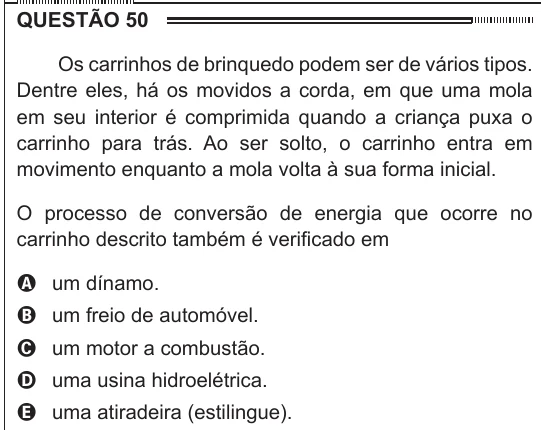

Texto extraído (pode conter ruído)

QUESTÃO 50  
Os carrinhos de brinquedo podem ser de vários tipos.  
Dentre eles, há os movidos a corda, em que uma mola  
em seu interior é comprimida quando a criança puxa o  
carrinho para trás. Ao ser solto, o carrinho entra em  
movimento enquanto a mola volta à sua forma inicial.  
O processo de conversão de energia que ocorre no  
carrinho descrito também é verificado em  
A um dínamo.  
B um freio de automóvel.  
C um motor a combustão.  
D uma usina hidroelétrica.  
E uma atiradeira (estilingue).

