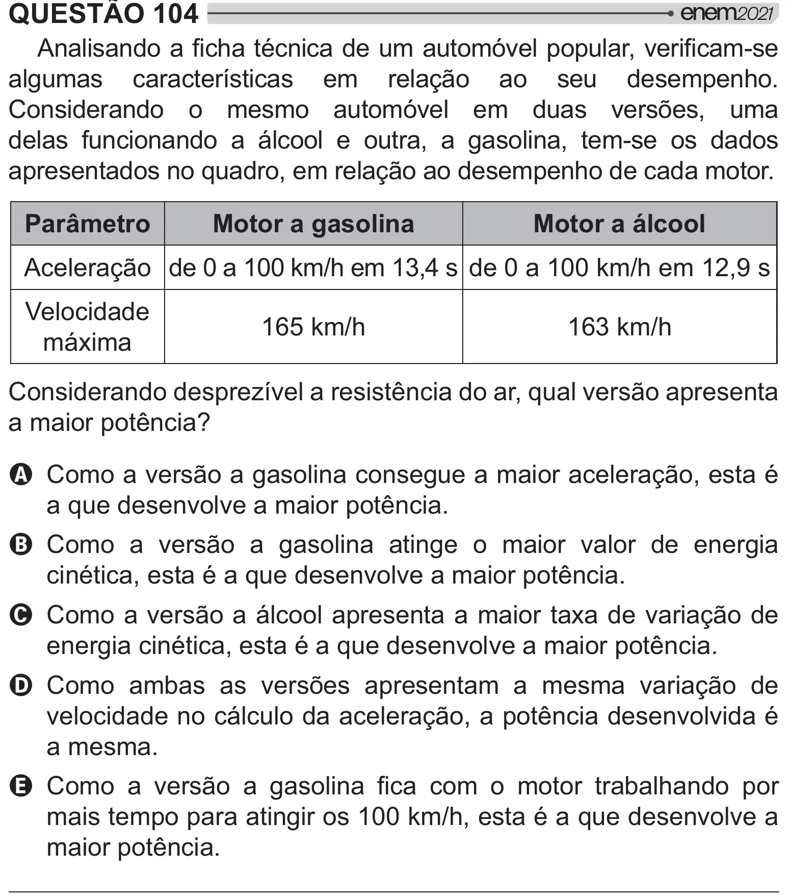

Texto extraído (pode conter ruído)

QUESTÃO 104  
 $ <   ƒ" ## "    
algumas características em relação ao seu desempenho.  
Considerando o mesmo automóvel em duas versões, uma  
delas funcionando a álcool e outra, a gasolina, tem-se os dados  
apresentados no quadro, em relação ao desempenho de cada motor.  
Parâmetro  
Motor a gasolina  
Motor a álcool  
Aceleração de 0 a 100 km/h em 13,4 s de 0 a 100 km/h em 12,9 s  
Velocidade  
165 km/h  
163 km/h  
máxima  
Considerando desprezível a resistência do ar, qual versão apresenta  
# +]  
A Como a versão a gasolina consegue a maior aceleração, esta é  
a que desenvolve a maior potência.  
B Como a versão a gasolina atinge o maior valor de energia  
cinética, esta é a que desenvolve a maior potência.  
C Como a versão a álcool apresenta a maior taxa de variação de  
energia cinética, esta é a que desenvolve a maior potência.  
D Como ambas as versões apresentam a mesma variação de  
velocidade no cálculo da aceleração, a potência desenvolvida é  
a mesma.  
E   "  [         y$ #  
mais tempo para atingir os 100 km/h, esta é a que desenvolve a  
maior potência.

