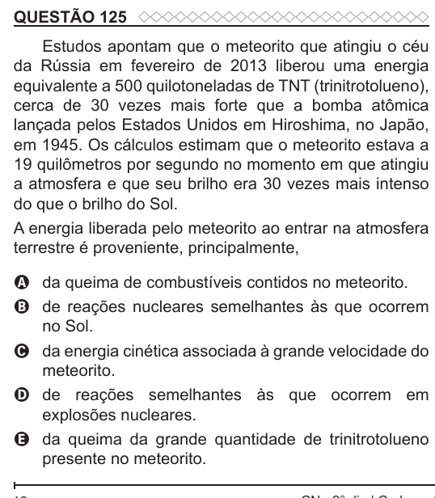

Texto extraído (pode conter ruído)

QUESTÃO 125  
Estudos apontam que o meteorito que atingiu o céu  
da Rússia em fevereiro de 2013 liberou uma energia  
equivalente a 500 quilotoneladas de TNT (trinitrotolueno),  
cerca de 30 vezes mais forte que a bomba atômica  
lançada pelos Estados Unidos em Hiroshima, no Japão,  
em 1945. Os cálculos estimam que o meteorito estava a  
19 quilômetros por segundo no momento em que atingiu  
a atmosfera e que seu brilho era 30 vezes mais intenso  
do que o brilho do Sol.  
A energia liberada pelo meteorito ao entrar na atmosfera  
terrestre é proveniente, principalmente,  
A da queima de combustíveis contidos no meteorito.  
B de reações nucleares semelhantes às que ocorrem  
no Sol.  
C da energia cinética associada à grande velocidade do  
meteorito.  
D de reações semelhantes às que ocorrem em  
explosões nucleares.  
E da queima da grande quantidade de trinitrotolueno  
presente no meteorito.

