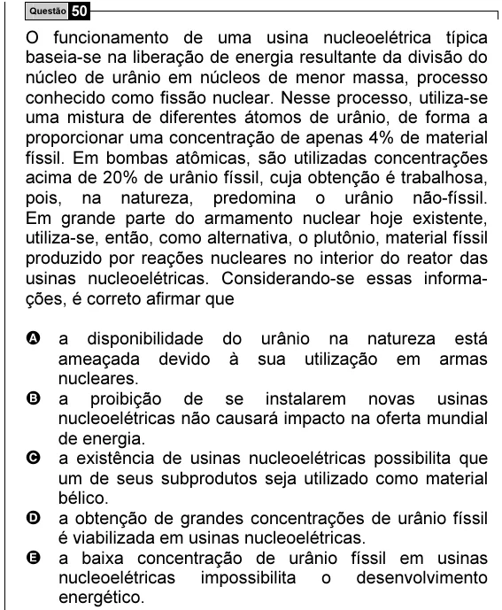

Texto extraído (pode conter ruído)

Questão 50  
O funcionamento de uma usina nucleoelétrica típica  
baseia-se na liberação de energia resultante da divisão do  
núcleo de urânio em núcleos de menor massa, processo  
conhecido como fissão nuclear. Nesse processo, utiliza-se  
uma mistura de diferentes átomos de urânio, de forma a  
proporcionar uma concentração de apenas 4% de material  
físsil. Em bombas atômicas, são utilizadas concentrações  
acima de 20% de urânio físsil, cuja obtenção é trabalhosa,  
pois, na natureza, predomina o urânio não-físsil.  
Em grande parte do armamento nuclear hoje existente,  
utiliza-se, então, como alternativa, o plutônio, material físsil  
produzido por reações nucleares no interior do reator das  
usinas nucleoelétricas. Considerando-se essas informa-  
ções, é correto afirmar que  
A a disponibilidade do urânio na natureza está  
ameaçada devido à sua utilização em armas  
nucleares.  
B a proibição de se instalarem novas usinas  
nucleoelétricas não causará impacto na oferta mundial  
de energia.  
C a existência de usinas nucleoelétricas possibilita que  
um de seus subprodutos seja utilizado como material  
bélico.  
D a obtenção de grandes concentrações de urânio físsil  
é viabilizada em usinas nucleoelétricas.  
E a baixa concentração de urânio físsil em usinas  
nucleoelétricas impossibilita o desenvolvimento  
energético.

