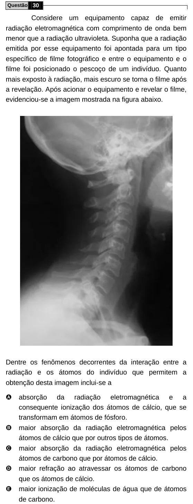

Texto extraído (pode conter ruído)

Questão 30  
Considere um equipamento capaz de emitir  
radiação eletromagnética com comprimento de onda bem  
menor que a radiação ultravioleta. Suponha que a radiação  
emitida por esse equipamento foi apontada para um tipo  
específico de filme fotográfico e entre o equipamento e o  
filme foi posicionado o pescoço de um indivíduo. Quanto  
mais exposto à radiação, mais escuro se torna o filme após  
a revelação. Após acionar o equipamento e revelar o filme,  
evidenciou-se a imagem mostrada na figura abaixo.  
Dentre os fenômenos decorrentes da interação entre a  
radiação e os átomos do indivíduo que permitem a  
obtenção desta imagem inclui-se a  
A  
absorção da radiação eletromagnética e a  
consequente ionização dos átomos de cálcio, que se  
transformam em átomos de fósforo.  
B  
maior absorção da radiação eletromagnética pelos  
átomos de cálcio que por outros tipos de átomos.  
C  
maior absorção da radiação eletromagnética pelos  
átomos de carbono que por átomos de cálcio.  
D  
maior refração ao atravessar os átomos de carbono  
que os átomos de cálcio.  
E  
maior ionização de moléculas de água que de átomos  
de carbono.

