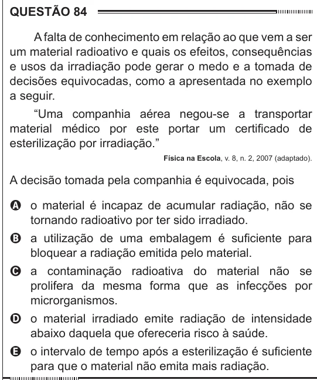

Texto extraído (pode conter ruído)

QUESTÃO 84  
A falta de conhecimento em relação ao que vem a ser  
um material radioativo e quais os efeitos, consequências  
e usos da irradiação pode gerar o medo e a tomada de  
decisões equivocadas, como a apresentada no exemplo  
a seguir.  
“Uma companhia aérea negou-se a transportar  
material médico por este portar um certificado de  
esterilização por irradiação.”  
Física na Escola, v. 8, n. 2, 2007 (adaptado).  
A decisão tomada pela companhia é equivocada, pois  
A o material é incapaz de acumular radiação, não se  
tornando radioativo por ter sido irradiado.  
B a utilização de uma embalagem é suficiente para  
bloquear a radiação emitida pelo material.  
C a contaminação radioativa do material não se  
prolifera da mesma forma que as infecções por  
microrganismos.  
D o material irradiado emite radiação de intensidade  
abaixo daquela que ofereceria risco à saúde.  
E o intervalo de tempo após a esterilização é suficiente  
para que o material não emita mais radiação.

