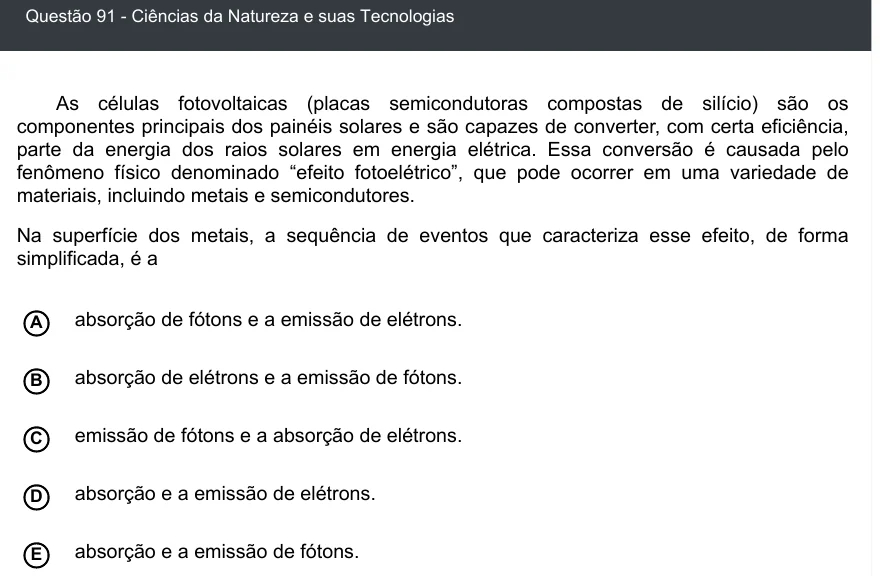

Texto extraído (pode conter ruído)

Questão 91 - Ciências da Natureza e suas Tecnologias  
As células fotovoltaicas (placas semicondutoras compostas de silício) são os  
componentes principais dos painéis solares e são capazes de converter, com certa eficiência,  
parte da energia dos raios solares em energia elétrica. Essa conversão é causada pelo  
fenômeno físico denominado “efeito fotoelétrico”, que pode ocorrer em uma variedade de  
materiais, incluindo metais e semicondutores.  
Na superfície dos metais, a sequência de eventos que caracteriza esse efeito, de forma  
simplificada, é a  
absorção de fótons e a emissão de elétrons.  
A  
B  
absorção de elétrons e a emissão de fótons.  
emissão de fótons e a absorção de elétrons.  
C  
absorção e a emissão de elétrons.  
D  
absorção e a emissão de fótons.  
E

