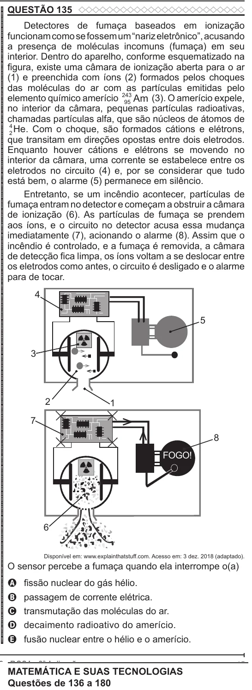

Texto extraído (pode conter ruído)

QUESTÃO 135  
ENEM 2022 ENEM 2022 ENEM 2022 ENEM 2022 ENEM 2022 ENEM 2022 ENEM 2022 ENEM 2022 ENEM 2022 ENEM 2022 ENEM 2022 ENEM 2022 ENEM 2022 ENEM 2022 ENEM 2022 ENEM 2022 ENEM 2022 ENEM 2022 ENEM 2022 ENEM 2022 ENEM 2022 ENEM 2022 ENEM 2022 ENEM 2022 ENEM 2022 ENEM 2022 ENEM 2022 ENEM 2022 ENEM 2022 ENEM 2022 ENEM 2022 ENEM 2022 ENEM 2022 ENEM 2022 ENEM 2022 ENEM 2022 ENEM 2022 ENEM 2022 ENEM 2022 ENEM 2022 ENEM 2022 ENEM 2022 ENEM 2022 ENEM 2022 ENEM 2022 ENEM 2022 ENEM 2022 ENEM 2022 ENEM 2022 ENEM 2022 ENEM 2022 ENEM 2022 ENEM 2022 ENEM 2022 ENEM 2022 ENEM 2022 ENEM 2022 ENEM 2022 ENEM 2022 ENEM 2022 ENEM 2022 ENEM 2022 ENEM 2022  
Detectores de fumaça baseados em ionização  
funcionam como se fossem um “nariz eletrônico”, acusando  
a presença de moléculas incomuns (fumaça) em seu  
interior. Dentro do aparelho, conforme esquematizado na  
figura, existe uma câmara de ionização aberta para o ar  
(1) e preenchida com íons (2) formados pelos choques  
das moléculas do ar com as partículas emitidas pelo  
elemento químico amerício 243  
95 Am  
(3). O amerício expele,  
no interior da câmara, pequenas partículas radioativas,  
chamadas partículas alfa, que são núcleos de átomos de  
2 He . Com o choque, são formados cátions e elétrons,  
4  
que transitam em direções opostas entre dois eletrodos.  
Enquanto houver cátions e elétrons se movendo no  
interior da câmara, uma corrente se estabelece entre os  
eletrodos no circuito (4) e, por se considerar que tudo  
está bem, o alarme (5) permanece em silêncio.  
Entretanto, se um incêndio acontecer, partículas de  
fumaça entram no detector e começam a obstruir a câmara  
de ionização (6). As partículas de fumaça se prendem  
aos íons, e o circuito no detector acusa essa mudança  
imediatamente (7), acionando o alarme (8). Assim que o  
incêndio é controlado, e a fumaça é removida, a câmara  
de detecção fica limpa, os íons voltam a se deslocar entre  
os eletrodos como antes, o circuito é desligado e o alarme  
para de tocar.  
4  
5  
3  
2  
1  
7  
8  
FOGO!  
6  
Disponível em: www.explainthatstuff.com. Acesso em: 3 dez. 2018 (adaptado).  
O sensor percebe a fumaça quando ela interrompe o(a)  
fissão nuclear do gás hélio.  
A  
passagem de corrente elétrica.  
B  
transmutação das moléculas do ar.  
C  
D  
decaimento radioativo do amerício.  
E fusão nuclear entre o hélio e o amerício.  
MATEMÁTICA E SUAS TECNOLOGIAS  
Questões de 136 a 180

