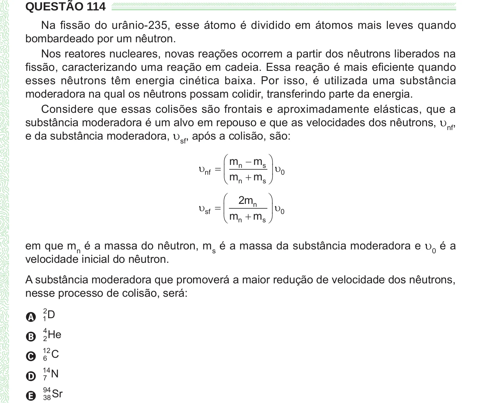

Texto extraído (pode conter ruído)

QUESTÃO 114  
Na fissão do urânio-235, esse átomo é dividido em átomos mais leves quando  
bombardeado por um nêutron.  
Nos reatores nucleares, novas reações ocorrem a partir dos nêutrons liberados na  
fissão, caracterizando uma reação em cadeia. Essa reação é mais eficiente quando  
esses nêutrons têm energia cinética baixa. Por isso, é utilizada uma substância  
moderadora na qual os nêutrons possam colidir, transferindo parte da energia.  
Considere que essas colisões são frontais e aproximadamente elásticas, que a  
substância moderadora é um alvo em repouso e que as velocidades dos nêutrons, υ nf ,  
e da substância moderadora, υ sf , após a colisão, são:  
 m  m s   
 nf   n  
  0  
m  
  
m  
 n  
s   
 2 m n   
 sf    
  0  
m  
  
m  
 n  
s   
em que m n é a massa do nêutron, m s é a massa da substância moderadora e υ 0 é a  
velocidade inicial do nêutron.  
A substância moderadora que promoverá a maior redução de velocidade dos nêutrons,  
nesse processo de colisão, será:  
2  
A 1 D  
B 2 He  
4  
C 6 C  
12  
14  
D 7 N  
E 38 Sr  
94

