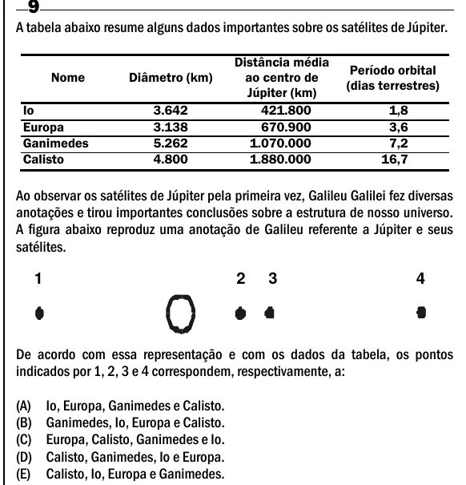

Texto extraído (pode conter ruído)

A tabela abaixo resume alguns dados importantes sobre os satélites de Júpiter.  
Distância média  
Período orbital  
Nome  
Diâmetro (km)  
ao centro de  
(dias terrestres)  
Júpiter (km)  
Io  
3.642  
421.800  
1,8  
Europa  
3.138  
670.900  
3,6  
Ganimedes  
5.262  
1.070.000  
7,2  
Calisto  
4.800  
1.880.000  
16,7  
Ao observar os satélites de Júpiter pela primeira vez, Galileu Galilei fez diversas  
anotações e tirou importantes conclusões sobre a estrutura de nosso universo.  
A figura abaixo reproduz uma anotação de Galileu referente a Júpiter e seus  
satélites.  
1  
2  
3  
4  
De acordo com essa representação e com os dados da tabela, os pontos  
indicados por 1, 2, 3 e 4 correspondem, respectivamente, a:  
(A)  
Io, Europa, Ganimedes e Calisto.  
(B)  
Ganimedes, Io, Europa e Calisto.  
(C)  
Europa, Calisto, Ganimedes e Io.  
(D)  
Calisto, Ganimedes, Io e Europa.  
(E)  
Calisto, Io, Europa e Ganimedes.

