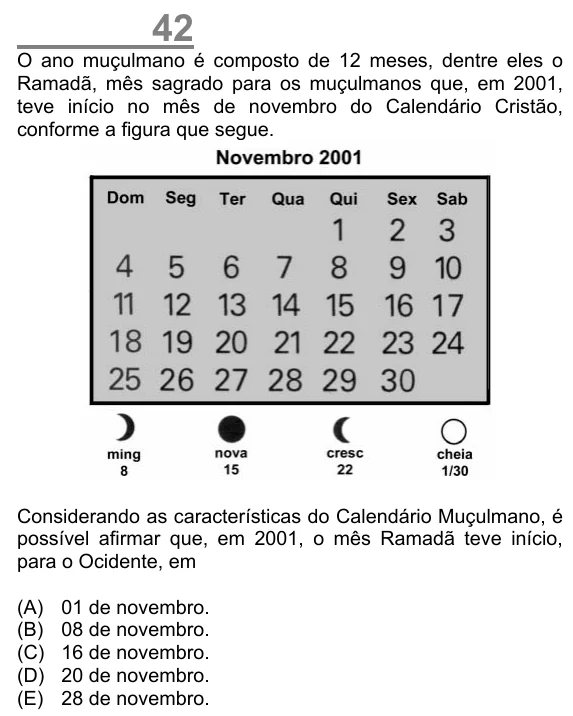

Texto extraído (pode conter ruído)

42  
O ano muçulmano é composto de 12 meses, dentre eles o  
Ramadã, mês sagrado para os muçulmanos que, em 2001,  
teve início no mês de novembro do Calendário Cristão,  
conforme a figura que segue.  
Considerando as características do Calendário Muçulmano, é  
possível afirmar que, em 2001, o mês Ramadã teve início,  
para o Ocidente, em  
(A)  
01 de novembro.  
(B)  
08 de novembro.  
(C)  
16 de novembro.  
(D)  
20 de novembro.  
(E)  
28 de novembro.

