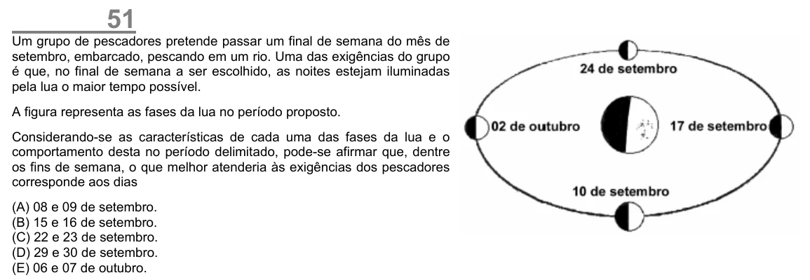

Texto extraído (pode conter ruído)

51  
Um grupo de pescadores pretende passar um final de semana do mês de  
setembro, embarcado, pescando em um rio. Uma das exigências do grupo  
é que, no final de semana a ser escolhido, as noites estejam iluminadas  
pela lua o maior tempo possível.  
A figura representa as fases da lua no período proposto.  
Considerando-se as características de cada uma das fases da lua e o  
comportamento desta no período delimitado, pode-se afirmar que, dentre  
os fins de semana, o que melhor atenderia às exigências dos pescadores  
corresponde aos dias  
(A) 08 e 09 de setembro.  
(B) 15 e 16 de setembro.  
(C) 22 e 23 de setembro.  
(D) 29 e 30 de setembro.  
(E) 06 e 07 de outubro.

