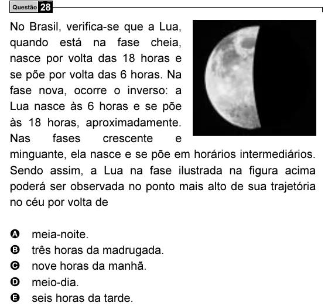

Texto extraído (pode conter ruído)

Questão 28  
No Brasil, verifica-se que a Lua,  
quando está na fase cheia,  
nasce por volta das 18 horas e  
se põe por volta das 6 horas. Na  
fase nova, ocorre o inverso: a  
Lua nasce às 6 horas e se põe  
às 18 horas, aproximadamente.  
Nas  
fases  
crescente  
e  
minguante, ela nasce e se põe em horários intermediários.  
Sendo assim, a Lua na fase ilustrada na figura acima  
poderá ser observada no ponto mais alto de sua trajetória  
no céu por volta de  
A  
meia-noite.  
B  
três horas da madrugada.  
C  
nove horas da manhã.  
D  
meio-dia.  
E  
seis horas da tarde.

