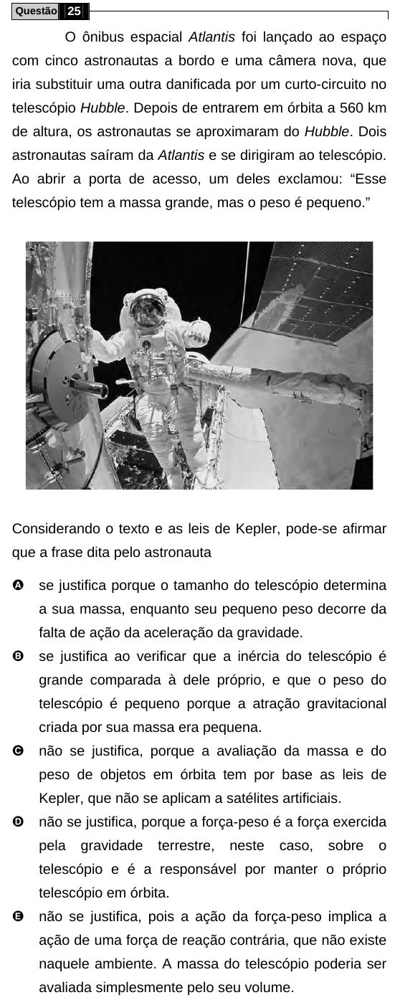

Texto extraído (pode conter ruído)

Questão 25  
O ônibus espacial Atlantis foi lançado ao espaço  
com cinco astronautas a bordo e uma câmera nova, que  
iria substituir uma outra danificada por um curto-circuito no  
telescópio Hubble. Depois de entrarem em órbita a 560 km  
de altura, os astronautas se aproximaram do Hubble. Dois  
astronautas saíram da Atlantis e se dirigiram ao telescópio.  
Ao abrir a porta de acesso, um deles exclamou: “Esse  
telescópio tem a massa grande, mas o peso é pequeno.”  
Considerando o texto e as leis de Kepler, pode-se afirmar  
que a frase dita pelo astronauta  
A  
se justifica porque o tamanho do telescópio determina  
a sua massa, enquanto seu pequeno peso decorre da  
falta de ação da aceleração da gravidade.  
B  
se justifica ao verificar que a inércia do telescópio é  
grande comparada à dele próprio, e que o peso do  
telescópio é pequeno porque a atração gravitacional  
criada por sua massa era pequena.  
C  
não se justifica, porque a avaliação da massa e do  
peso de objetos em órbita tem por base as leis de  
Kepler, que não se aplicam a satélites artificiais.  
D  
não se justifica, porque a força-peso é a força exercida  
pela  
gravidade  
terrestre,  
neste  
caso,  
sobre  
o  
telescópio e é a responsável por manter o próprio  
telescópio em órbita.  
E  
não se justifica, pois a ação da força-peso implica a  
ação de uma força de reação contrária, que não existe  
naquele ambiente. A massa do telescópio poderia ser  
avaliada simplesmente pelo seu volume.

