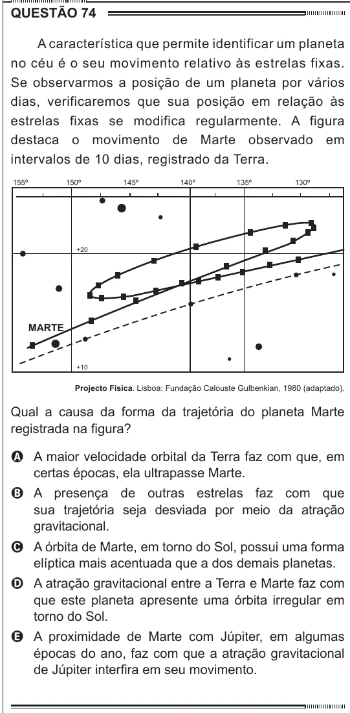

Texto extraído (pode conter ruído)

QUESTÃO 74  
A característica que permite identificar um planeta  
no céu é o seu movimento relativo às estrelas fixas.  
Se observarmos a posição de um planeta por vários  
dias, verificaremos que sua posição em relação às  
estrelas fixas se modifica regularmente. A figura  
destaca o movimento de Marte observado em  
intervalos de 10 dias, registrado da Terra.  
155º  
150º  
145º  
140º  
135º  
130º  
+20  
MARTE  
+10  
Projecto Física. Lisboa: Fundação Calouste Gulbenkian, 1980 (adaptado).  
Qual a causa da forma da trajetória do planeta Marte  
registrada na figura?  
A A maior velocidade orbital da Terra faz com que, em  
certas épocas, ela ultrapasse Marte.  
B A presença de outras estrelas faz com que  
sua trajetória seja desviada por meio da atração  
gravitacional.  
C A órbita de Marte, em torno do Sol, possui uma forma  
elíptica mais acentuada que a dos demais planetas.  
D A atração gravitacional entre a Terra e Marte faz com  
que este planeta apresente uma órbita irregular em  
torno do Sol.  
E A proximidade de Marte com Júpiter, em algumas  
épocas do ano, faz com que a atração gravitacional  
de Júpiter interfira em seu movimento.

