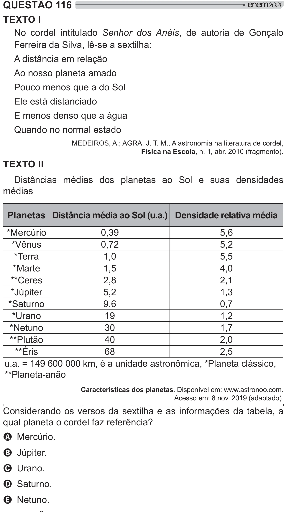

Texto extraído (pode conter ruído)

QUESTÃO 116  
TEXTO I  
No cordel intitulado Senhor dos Anéis, de autoria de Gonçalo  
Ferreira da Silva, lê-se a sextilha:  
A distância em relação  
Ao nosso planeta amado  
Pouco menos que a do Sol  
Ele está distanciado  
E menos denso que a água  
Quando no normal estado  
MEDEIROS, A.; AGRA, J. T. M., A astronomia na literatura de cordel,  
Física na Escola, n. 1, abr. 2010 (fragmento).  
TEXTO II  
Distâncias médias dos planetas ao Sol e suas densidades  
médias  
Planetas Distância média ao Sol (u.a.) Densidade relativa média  
*Mercúrio  
0,39  
5,6  
*Vênus  
0,72  
5,2  
*Terra  
1,0  
5,5  
*Marte  
1,5  
4,0  
**Ceres  
2,8  
2,1  
*Júpiter  
5,2  
1,3  
*Saturno  
9,6  
0,7  
*Urano  
19  
1,2  
*Netuno  
30  
1,7  
**Plutão  
40  
2,0  
**Éris  
68  
2,5  
!!§`¨©_____‚<   2« /   
**Planeta-anão  
Características dos planetas. Disponível em: www.astronoo.com.  
Acesso em: 8 nov. 2019 (adaptado).  
Considerando os versos da sextilha e as informações da tabela, a  
#  > > +]  
A Mercúrio.  
B Júpiter.  
C Urano.  
D Saturno.  
E Netuno.

