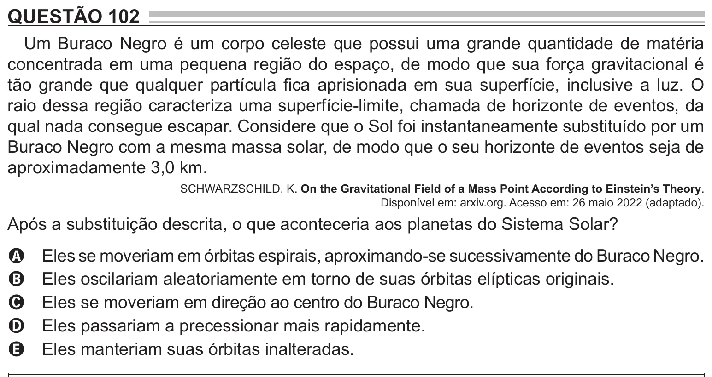

Texto extraído (pode conter ruído)

QUESTÃO 102  
Um Buraco Negro é um corpo celeste que possui uma grande quantidade de matéria  
concentrada em uma pequena região do espaço, de modo que sua força gravitacional é  
tão grande que qualquer partícula fica aprisionada em sua superfície, inclusive a luz. O  
raio dessa região caracteriza uma superfície-limite, chamada de horizonte de eventos, da  
qual nada consegue escapar. Considere que o Sol foi instantaneamente substituído por um  
Buraco Negro com a mesma massa solar, de modo que o seu horizonte de eventos seja de  
aproximadamente 3,0 km.  
SCHWARZSCHILD, K. On the Gravitational Field of a Mass Point According to Einstein’s Theory.  
Disponível em: arxiv.org. Acesso em: 26 maio 2022 (adaptado).  
Após a substituição descrita, o que aconteceria aos planetas do Sistema Solar?  
 les se moveriam em órbitas espirais, aproximando-se sucessivamente do Buraco Negro.  
E  
A  
Eles oscilariam aleatoriamente em torno de suas órbitas elípticas originais.  
B  
Eles se moveriam em direção ao centro do Buraco Negro.  
C  
Eles passariam a precessionar mais rapidamente.  
D  
Eles manteriam suas órbitas inalteradas.  
E

