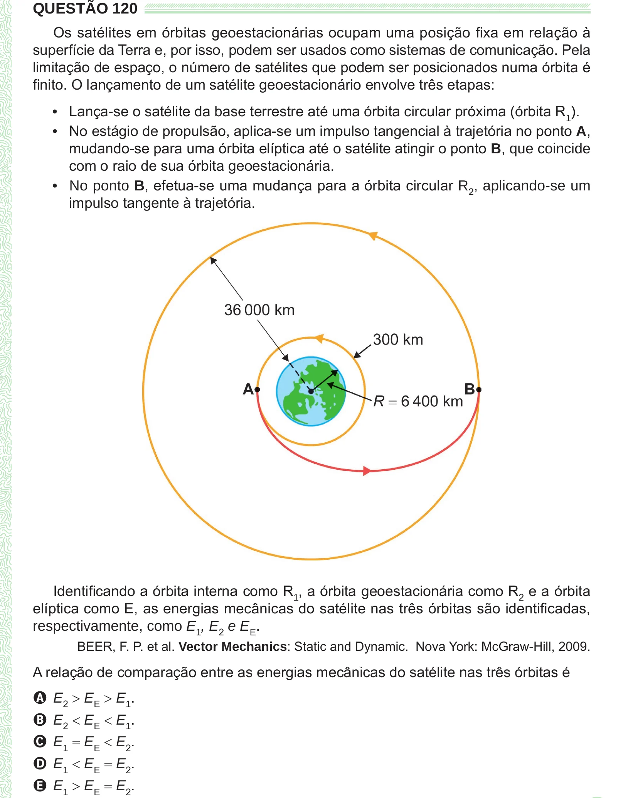

Texto extraído (pode conter ruído)

QUESTÃO 120  
Os satélites em órbitas geoestacionárias ocupam uma posição fixa em relação à  
superfície da Terra e, por isso, podem ser usados como sistemas de comunicação. Pela  
limitação de espaço, o número de satélites que podem ser posicionados numa órbita é  
finito. O lançamento de um satélite geoestacionário envolve três etapas:  
• Lança-se o satélite da base terrestre até uma órbita circular próxima (órbita R 1 ).  
• No estágio de propulsão, aplica-se um impulso tangencial à trajetória no ponto A,  
mudando-se para uma órbita elíptica até o satélite atingir o ponto B, que coincide  
com o raio de sua órbita geoestacionária.  
• No ponto B, efetua-se uma mudança para a órbita circular R 2 , aplicando-se um  
impulso tangente à trajetória.  
Identificando a órbita interna como R 1 , a órbita geoestacionária como R 2 e a órbita  
elíptica como E, as energias mecânicas do satélite nas três órbitas são identificadas,  
respectivamente, como E 1 , E 2 e E E .  
BEER, F. P. et al. Vector Mechanics: Static and Dynamic. Nova York: McGraw-Hill, 2009.  
A relação de comparação entre as energias mecânicas do satélite nas três órbitas é  
A E 2 > E E > E 1 .  
B E 2 < E E < E 1 .  
C E 1 = E E < E 2 .  
D E 1 < E E = E 2 .  
E E 1 > E E = E 2 .

