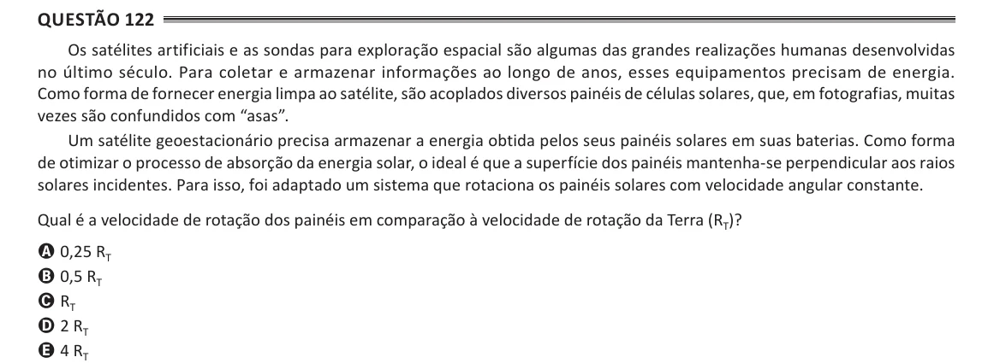

Texto extraído (pode conter ruído)

Questão 122  
Os satélites artificiais e as sondas para exploração espacial são algumas das grandes realizações humanas desenvolvidas  
no último século. Para coletar e armazenar informações ao longo de anos, esses equipamentos precisam de energia.  
Como forma de fornecer energia limpa ao satélite, são acoplados diversos painéis de células solares, que, em fotografias, muitas  
vezes são confundidos com “asas”.  
Um satélite geoestacionário precisa armazenar a energia obtida pelos seus painéis solares em suas baterias. Como forma  
de otimizar o processo de absorção da energia solar, o ideal é que a superfície dos painéis mantenha-se perpendicular aos raios  
solares incidentes. Para isso, foi adaptado um sistema que rotaciona os painéis solares com velocidade angular constante.  
Qual é a velocidade de rotação dos painéis em comparação à velocidade de rotação da Terra (R T )?  
A 0,25 R T  
B 0,5 R T  
C R T  
D 2 R T  
E 4 R T

