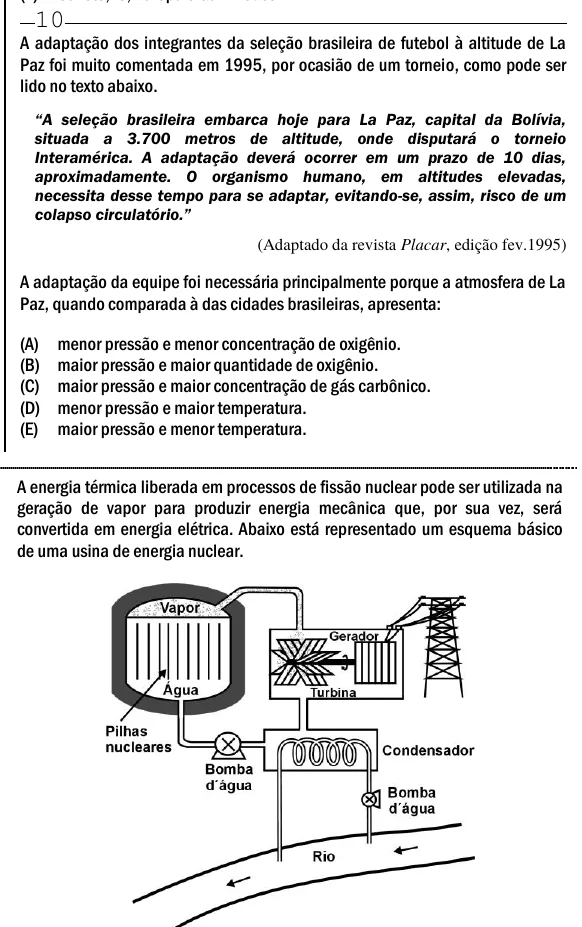

Texto extraído (pode conter ruído)

10  
A adaptação dos integrantes da seleção brasileira de futebol à altitude de La  
Paz foi muito comentada em 1995, por ocasião de um torneio, como pode ser  
lido no texto abaixo.  
―A seleção brasileira embarca hoje para La Paz, capital da Bolívia,  
situada a 3.700 metros de altitude, onde disputará o torneio  
Interamérica. A adaptação deverá ocorrer em um prazo de 10 dias,  
aproximadamente. O organismo humano, em altitudes elevadas,  
necessita desse tempo para se adaptar, evitando-se, assim, risco de um  
colapso circulatório.‖  
(Adaptado da revista Placar, edição fev.1995)  
A adaptação da equipe foi necessária principalmente porque a atmosfera de La  
Paz, quando comparada à das cidades brasileiras, apresenta:  
(A)  
menor pressão e menor concentração de oxigênio.  
(B)  
maior pressão e maior quantidade de oxigênio.  
(C)  
maior pressão e maior concentração de gás carbônico.  
(D)  
menor pressão e maior temperatura.  
(E)  
maior pressão e menor temperatura.  
A energia térmica liberada em processos de fissão nuclear pode ser utilizada na  
geração de vapor para produzir energia mecânica que, por sua vez, será  
convertida em energia elétrica. Abaixo está representado um esquema básico  
de uma usina de energia nuclear.

