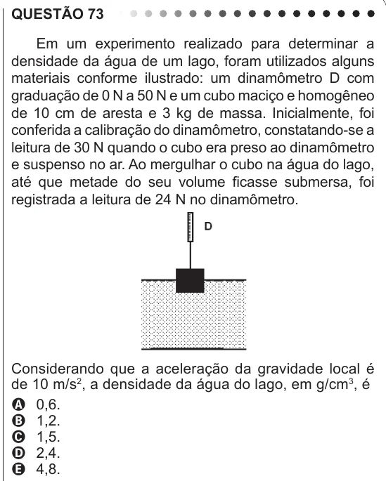

Texto extraído (pode conter ruído)

QUESTÃO 73  
Em um experimento realizado para determinar a  
densidade da água de um lago, foram utilizados alguns  
materiais conforme ilustrado: um dinamômetro D com  
graduação de 0 N a 50 N e um cubo maciço e homogêneo  
de 10 cm de aresta e 3 kg de massa. Inicialmente, foi  
conferida a calibração do dinamômetro, constatando-se a  
leitura de 30 N quando o cubo era preso ao dinamômetro  
e suspenso no ar. Ao mergulhar o cubo na água do lago,  
até que metade do seu volume ficasse submersa, foi  
registrada a leitura de 24 N no dinamômetro.  
Considerando que a aceleração da gravidade local é  
de 10 m/s 2 , a densidade da água do lago, em g/cm 3 , é  
A 0,6.  
B 1,2.  
C 1,5.  
D 2,4.  
E 4,8.

