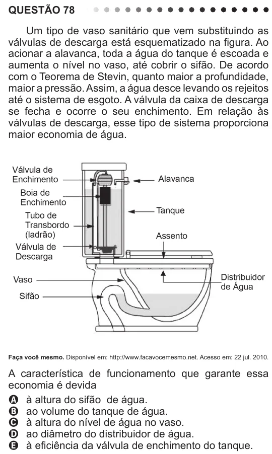

Texto extraído (pode conter ruído)

QUESTÃO 78  
Um tipo de vaso sanitário que vem substituindo as  
válvulas de descarga está esquematizado na figura. Ao  
acionar a alavanca, toda a água do tanque é escoada e  
aumenta o nível no vaso, até cobrir o sifão. De acordo  
com o Teorema de Stevin, quanto maior a profundidade,  
maior a pressão. Assim, a água desce levando os rejeitos  
até o sistema de esgoto. A válvula da caixa de descarga  
se fecha e ocorre o seu enchimento. Em relação às  
válvulas de descarga, esse tipo de sistema proporciona  
maior economia de água.  
Faça você mesmo. Disponível em: http://www.facavocemesmo.net. Acesso em: 22 jul. 2010.  
A característica de funcionamento que garante essa  
economia é devida  
A à altura do sifão de água.  
B ao volume do tanque de água.  
C à altura do nível de água no vaso.  
D ao diâmetro do distribuidor de água.  
E à eficiência da válvula de enchimento do tanque.

