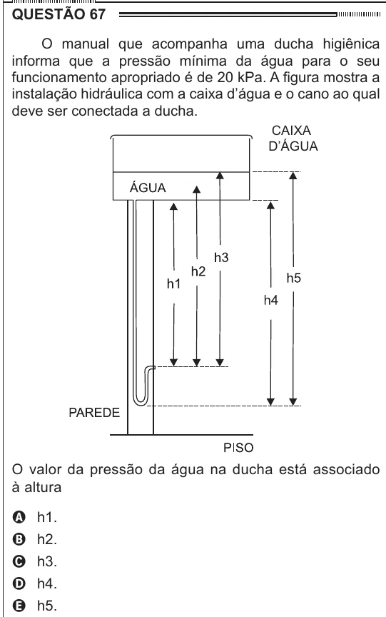

Texto extraído (pode conter ruído)

QUESTÃO 67  
O manual que acompanha uma ducha higiênica  
informa que a pressão mínima da água para o seu  
funcionamento apropriado é de 20 kPa. A figura mostra a  
instalação hidráulica com a caixa d’água e o cano ao qual  
deve ser conectada a ducha.  
CAIXA  
D’ÁGUA  
O valor da pressão da água na ducha está associado  
à altura  
A h1.  
B h2.  
C h3.  
D h4.  
E h5.

