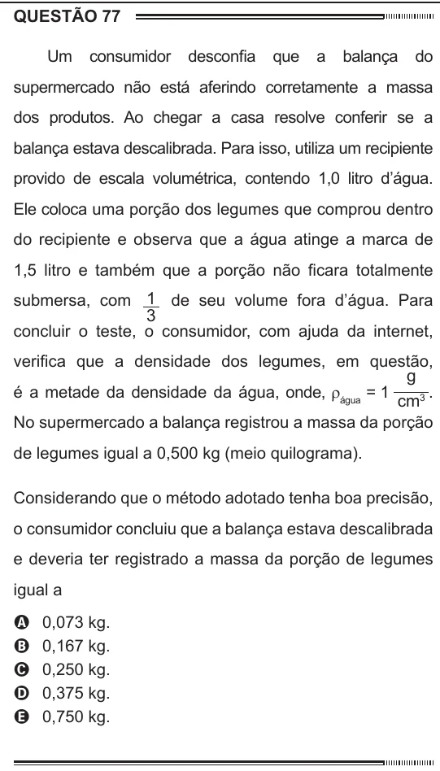

Texto extraído (pode conter ruído)

QUESTÃO 77  
Um  
consumidor  
desconfia  
que  
a  
balança  
do  
supermercado não está aferindo corretamente a massa  
dos produtos. Ao chegar a casa resolve conferir se a  
balança estava descalibrada. Para isso, utiliza um recipiente  
provido de escala volumétrica, contendo 1,0 litro d’água.  
Ele coloca uma porção dos legumes que comprou dentro  
do recipiente e observa que a água atinge a marca de  
1,5 litro e também que a porção não ficara totalmente  
submersa, com 1 de seu volume fora d’água. Para  
3  
concluir o teste, o consumidor, com ajuda da internet,  
verifica que a densidade dos legumes, em questão,  
g  
é a metade da densidade da água, onde, r água = 1  
.  
cm 3  
No supermercado a balança registrou a massa da porção  
de legumes igual a 0,500 kg (meio quilograma).  
Considerando que o método adotado tenha boa precisão,  
o consumidor concluiu que a balança estava descalibrada  
e deveria ter registrado a massa da porção de legumes  
igual a  
0,073 kg.  
A  
0,167 kg.  
B  
C  
0,250 kg.  
0,375 kg.  
D  
0,750 kg.  
E

