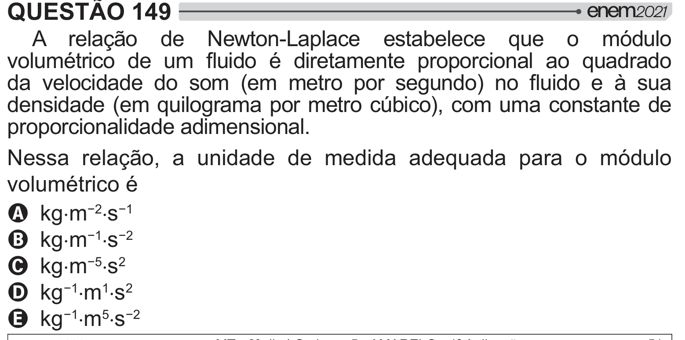

Texto extraído (pode conter ruído)

QUESTÃO 149  
A relação de Newton-Laplace estabelece que o módulo  
" <     }  <     ##    
 "     J    #  W  }   ¸   
densidade (em quilograma por metro cúbico), com uma constante de  
proporcionalidade adimensional.  
Nessa relação, a unidade de medida adequada para o módulo  
volumétrico é  
A kg˜m ” ˜s `  
B kg˜m ` ˜s ‘  
C kg˜m  ˜s 2  
D kg ` ˜m 1 ˜s 2  
E kg ` ˜m 5 ˜s ‘

