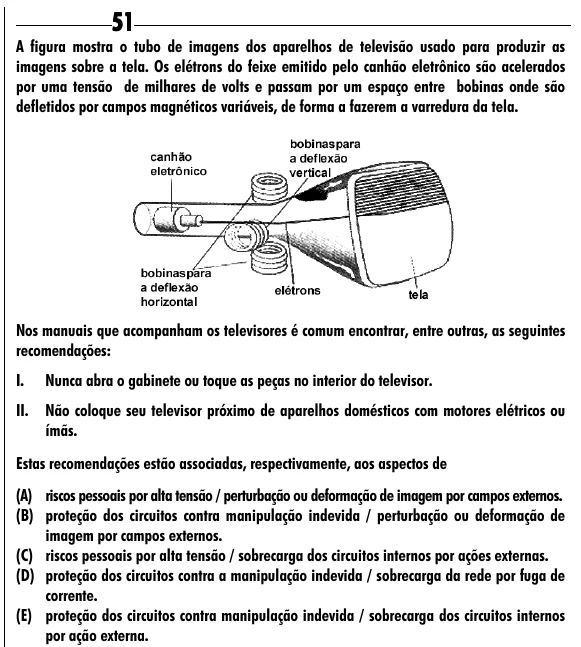

Texto extraído (pode conter ruído)

51  
A figura mostra o tubo de imagens dos aparelhos de televisão usado para produzir as  
imagens sobre a tela. Os elétrons do feixe emitido pelo canhão eletrônico são acelerados  
por uma tensão de milhares de volts e passam por um espaço entre bobinas onde são  
defletidos por campos magnéticos variáveis, de forma a fazerem a varredura da tela.  
Nos manuais que acompanham os televisores é comum encontrar, entre outras, as seguintes  
recomendações:  
I.  
Nunca abra o gabinete ou toque as peças no interior do televisor.  
II.  
Não coloque seu televisor próximo de aparelhos domésticos com motores elétricos ou  
ímãs.  
Estas recomendações estão associadas, respectivamente, aos aspectos de  
(A) riscos pessoais por alta tensão / perturbação ou deformação de imagem por campos externos.  
(B) proteção dos circuitos contra manipulação indevida / perturbação ou deformação de  
imagem por campos externos.  
(C) riscos pessoais por alta tensão / sobrecarga dos circuitos internos por ações externas.  
(D) proteção dos circuitos contra a manipulação indevida / sobrecarga da rede por fuga de  
corrente.  
(E) proteção dos circuitos contra manipulação indevida / sobrecarga dos circuitos internos  
por ação externa.

