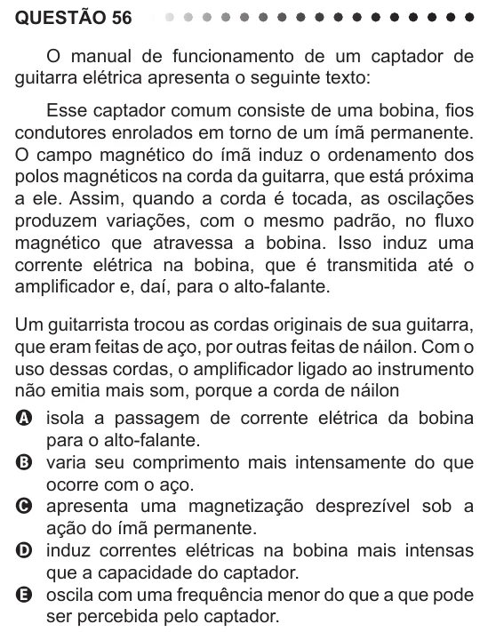

Texto extraído (pode conter ruído)

QUESTÃO 56  
O manual de funcionamento de um captador de  
guitarra elétrica apresenta o seguinte texto:  
Esse captador comum consiste de uma bobina, fios  
condutores enrolados em torno de um ímã permanente.  
O campo magnético do ímã induz o ordenamento dos  
polos magnéticos na corda da guitarra, que está próxima  
a ele. Assim, quando a corda é tocada, as oscilações  
produzem variações, com o mesmo padrão, no fluxo  
magnético que atravessa a bobina. Isso induz uma  
corrente elétrica na bobina, que é transmitida até o  
amplificador e, daí, para o alto-falante.  
Um guitarrista trocou as cordas originais de sua guitarra,  
que eram feitas de aço, por outras feitas de náilon. Com o  
uso dessas cordas, o amplificador ligado ao instrumento  
não emitia mais som, porque a corda de náilon  
A isola a passagem de corrente elétrica da bobina  
para o alto-falante.  
B varia seu comprimento mais intensamente do que  
ocorre com o aço.  
C apresenta uma magnetização desprezível sob a  
ação do ímã permanente.  
D induz correntes elétricas na bobina mais intensas  
que a capacidade do captador.  
E oscila com uma frequência menor do que a que pode  
ser percebida pelo captador.

