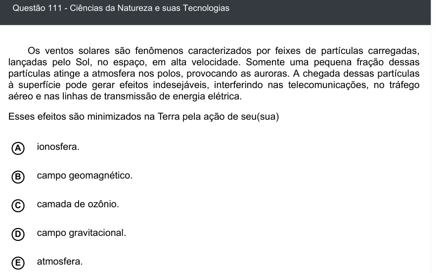

Texto extraído (pode conter ruído)

Questão 111 - Ciências da Natureza e suas Tecnologias  
Os ventos solares são fenômenos caracterizados por feixes de partículas carregadas,  
lançadas pelo Sol, no espaço, em alta velocidade. Somente uma pequena fração dessas  
partículas atinge a atmosfera nos polos, provocando as auroras. A chegada dessas partículas  
à superfície pode gerar efeitos indesejáveis, interferindo nas telecomunicações, no tráfego  
aéreo e nas linhas de transmissão de energia elétrica.  
Esses efeitos são minimizados na Terra pela ação de seu(sua)  
A  
ionosfera.  
campo geomagnético.  
B  
camada de ozônio.  
C  
D  
campo gravitacional.  
atmosfera.  
E

