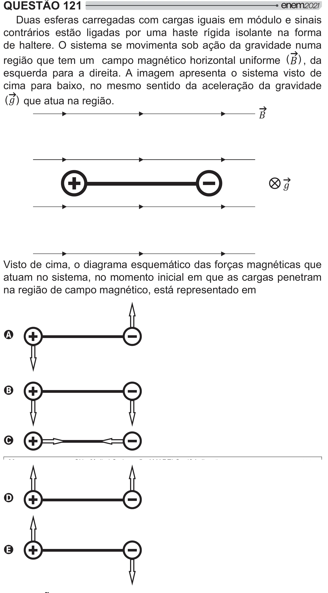

Texto extraído (pode conter ruído)

QUESTÃO 121  
Duas esferas carregadas com cargas iguais em módulo e sinais  
contrários estão ligadas por uma haste rígida isolante na forma  
de haltere. O sistema se movimenta sob ação da gravidade numa  
região que tem um campo magnético horizontal uniforme (  ) , da  
esquerda para a direita. A imagem apresenta o sistema visto de  
cima para baixo, no mesmo sentido da aceleração da gravidade  
() que atua na região.  
  
  
Visto de cima, o diagrama esquemático das forças magnéticas que  
atuam no sistema, no momento inicial em que as cargas penetram  
na região de campo magnético, está representado em  
A  
B  
C  
D  
E

