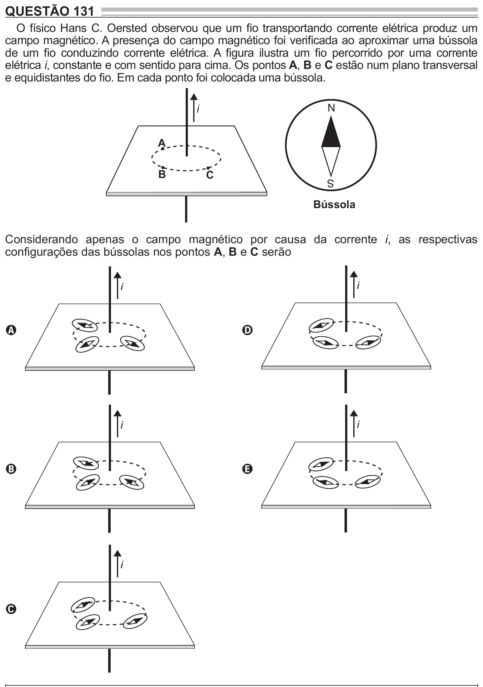

Texto extraído (pode conter ruído)

QUESTÃO 131  
O físico Hans C. Oersted observou que um fio transportando corrente elétrica produz um  
campo magnético. A presença do campo magnético foi verificada ao aproximar uma bússola  
de um fio conduzindo corrente elétrica. A figura ilustra um fio percorrido por uma corrente  
elétrica i, constante e com sentido para cima. Os pontos A, B e C estão num plano transversal  
e equidistantes do fio. Em cada ponto foi colocada uma bússola.  
N  
i  
A  
B  
C  
S  
Bússola  
Considerando apenas o campo magnético por causa da corrente i, as respectivas  
configurações das bússolas nos pontos A, B e C serão  
i  
i  
A  
D  
i  
i  
B  
E  
i  
C

