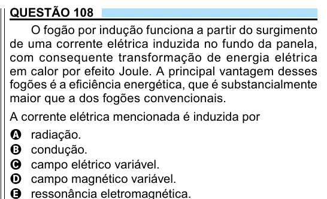

Texto extraído (pode conter ruído)

QUESTÃO 108  
O fogão por indução funciona a partir do surgimento  
de uma corrente elétrica induzida no fundo da panela,  
com consequente transformação de energia elétrica  
em calor por efeito Joule. A principal vantagem desses  
fogões é a eficiência energética, que é substancialmente  
maior que a dos fogões convencionais.  
A corrente elétrica mencionada é induzida por  
A radiação.  
B condução.  
C campo elétrico variável.  
D campo magnético variável.

