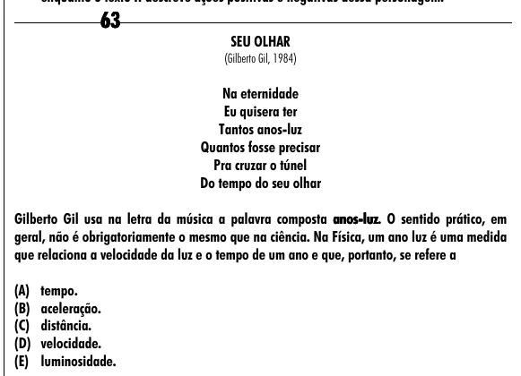

Texto extraído (pode conter ruído)

63  
SEU OLHAR  
(Gilberto Gil, 1984)  
Na eternidade  
Eu quisera ter  
Tantos anos-luz  
Quantos fosse precisar  
Pra cruzar o túnel  
Do tempo do seu olhar  
Gilberto Gil usa na letra da música a palavra composta anos-  
anos - luz.  
luz O sentido prático, em  
geral, não é obrigatoriamente o mesmo que na ciência. Na Física, um ano luz é uma medida  
que relaciona a velocidade da luz e o tempo de um ano e que, portanto, se refere a  
(A) tempo.  
(B) aceleração.  
(C) distância.  
(D) velocidade.  
(E) luminosidade.

