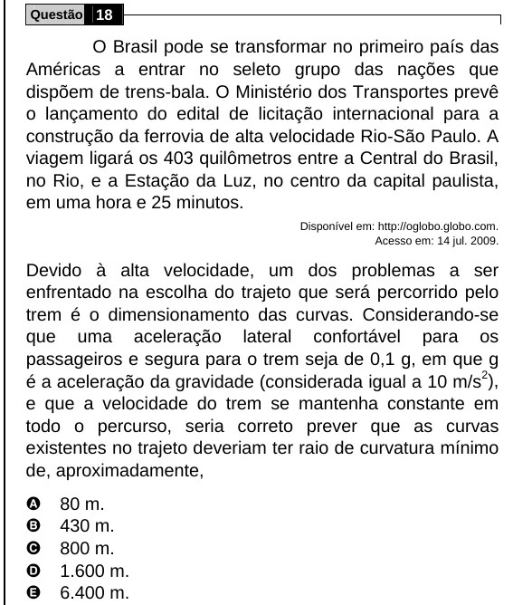

Texto extraído (pode conter ruído)

Questão 18  
O Brasil pode se transformar no primeiro país das  
Américas a entrar no seleto grupo das nações que  
dispõem de trens-bala. O Ministério dos Transportes prevê  
o lançamento do edital de licitação internacional para a  
construção da ferrovia de alta velocidade Rio-São Paulo. A  
viagem ligará os 403 quilômetros entre a Central do Brasil,  
no Rio, e a Estação da Luz, no centro da capital paulista,  
em uma hora e 25 minutos.  
Disponível em: http://oglobo.globo.com.  
Acesso em: 14 jul. 2009.  
Devido à alta velocidade, um dos problemas a ser  
enfrentado na escolha do trajeto que será percorrido pelo  
trem é o dimensionamento das curvas. Considerando-se  
que uma aceleração lateral confortável para os  
passageiros e segura para o trem seja de 0,1 g, em que g  
é a aceleração da gravidade (considerada igual a 10 m/s 2 ),  
e que a velocidade do trem se mantenha constante em  
todo o percurso, seria correto prever que as curvas  
existentes no trajeto deveriam ter raio de curvatura mínimo  
de, aproximadamente,  
A  
80 m.  
B  
430 m.  
C  
800 m.  
D  
1.600 m.  
E  
6.400 m.

