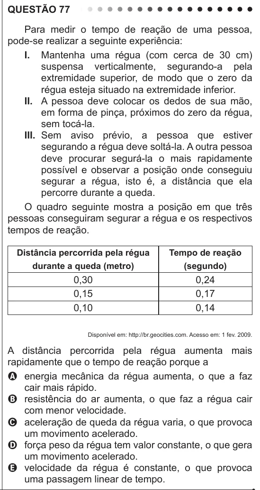

Texto extraído (pode conter ruído)

QUESTÃO 77  
Para medir o tempo de reação de uma pessoa,  
pode-se realizar a seguinte experiência:  
I. Mantenha uma régua (com cerca de 30 cm)  
suspensa verticalmente, segurando-a pela  
extremidade superior, de modo que o zero da  
régua esteja situado na extremidade inferior.  
II. A pessoa deve colocar os dedos de sua mão,  
em forma de pinça, próximos do zero da régua,  
sem tocá-la.  
III. Sem aviso prévio, a pessoa que estiver  
segurando a régua deve soltá-la. A outra pessoa  
deve procurar segurá-la o mais rapidamente  
possível e observar a posição onde conseguiu  
segurar a régua, isto é, a distância que ela  
percorre durante a queda.  
O quadro seguinte mostra a posição em que três  
pessoas conseguiram segurar a régua e os respectivos  
tempos de reação.  
Distância percorrida pela régua  
Tempo de reação  
durante a queda (metro)  
(segundo)  
0,30  
0,24  
0,15  
0,17  
0,10  
0,14  
Disponível em: http://br.geocities.com. Acesso em: 1 fev. 2009.  
A distância percorrida pela régua aumenta mais  
rapidamente que o tempo de reação porque a  
A energia mecânica da régua aumenta, o que a faz  
cair mais rápido.  
B resistência do ar aumenta, o que faz a régua cair  
com menor velocidade.  
C aceleração de queda da régua varia, o que provoca  
um movimento acelerado.  
D força peso da régua tem valor constante, o que gera  
um movimento acelerado.  
E velocidade da régua é constante, o que provoca  
uma passagem linear de tempo.

