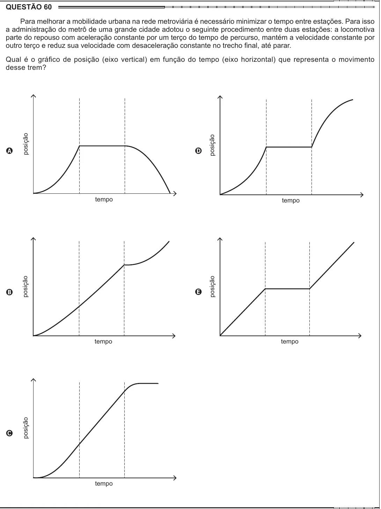

Texto extraído (pode conter ruído)

QUESTÃO 60  
Para melhorar a mobilidade urbana na rede metroviária é necessário minimizar o tempo entre estações. Para isso  
a administração do metrô de uma grande cidade adotou o seguinte procedimento entre duas estações: a locomotiva  
parte do repouso com aceleração constante por um terço do tempo de percurso, mantém a velocidade constante por  
outro terço e reduz sua velocidade com desaceleração constante no trecho final, até parar.  
Qual é o gráfico de posição (eixo vertical) em função do tempo (eixo horizontal) que representa o movimento  
desse trem?  
posição  
posição  
A  
D  
tempo  
tempo  
posição  
posição  
E  
B  
tempo  
tempo  
posição  
C  
tempo

