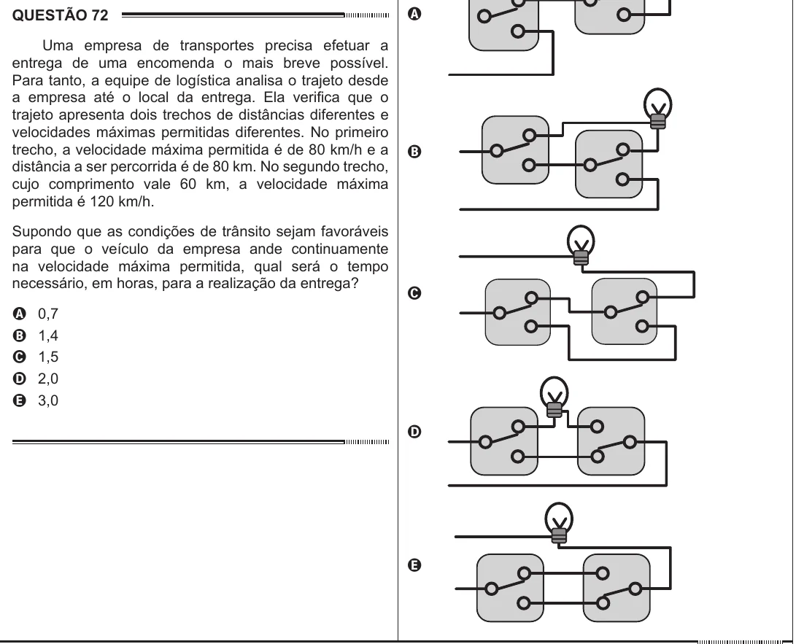

Texto extraído (pode conter ruído)

QUESTÃO 72  
A  
Uma empresa de transportes precisa efetuar a  
entrega de uma encomenda o mais breve possível.  
Para tanto, a equipe de logística analisa o trajeto desde  
a empresa até o local da entrega. Ela verifica que o  
trajeto apresenta dois trechos de distâncias diferentes e  
velocidades máximas permitidas diferentes. No primeiro  
trecho, a velocidade máxima permitida é de 80 km/h e a  
B  
distância a ser percorrida é de 80 km. No segundo trecho,  
cujo comprimento vale 60 km, a velocidade máxima  
permitida é 120 km/h.  
Supondo que as condições de trânsito sejam favoráveis  
para que o veículo da empresa ande continuamente  
na velocidade máxima permitida, qual será o tempo  
necessário, em horas, para a realização da entrega?  
C  
A  
0,7  
1,4  
B  
1,5  
C  
2,0  
D  
E  
3,0  
D  
E

