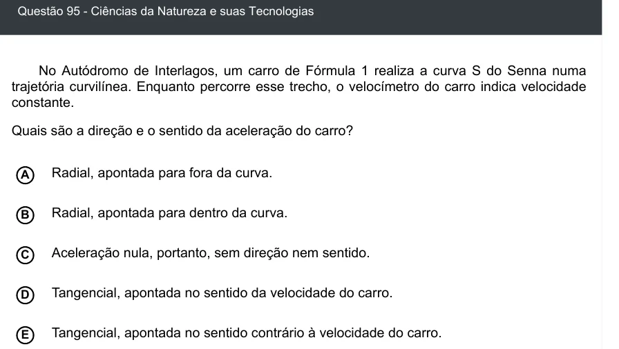

Texto extraído (pode conter ruído)

Questão 95 - Ciências da Natureza e suas Tecnologias  
No Autódromo de Interlagos, um carro de Fórmula 1 realiza a curva S do Senna numa  
trajetória curvilínea. Enquanto percorre esse trecho, o velocímetro do carro indica velocidade  
constante.  
Quais são a direção e o sentido da aceleração do carro?  
Radial, apontada para fora da curva.  
A  
B  
Radial, apontada para dentro da curva.  
Aceleração nula, portanto, sem direção nem sentido.  
C  
Tangencial, apontada no sentido da velocidade do carro.  
D  
E  
Tangencial, apontada no sentido contrário à velocidade do carro.

