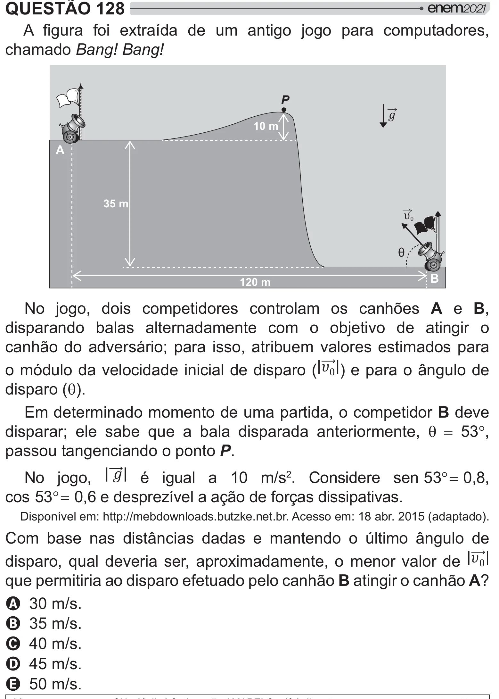

Texto extraído (pode conter ruído)

QUESTÃO 128  
   > * {      ‡ # #   
  
chamado Bang! Bang!  
P  
  
10 m  
A  
35 m  
υ 0  
θ  
B  
120 m  
No jogo, dois competidores controlam os canhões A e B,  
disparando balas alternadamente com o objetivo de atingir o  
canhão do adversário; para isso, atribuem valores estimados para  
o módulo da velocidade inicial de disparo (   ) e para o ângulo de  
disparo (T).  
Em determinado momento de uma partida, o competidor B deve  
disparar; ele sabe que a bala disparada anteriormente, T 53q,  
passou tangenciando o ponto P.  
No jogo,  é igual a 10 m/s 2 . Considere sen 53q 0,8,  
cos 53q 0,6 e desprezível a ação de forças dissipativas.  
Disponível em: http://mebdownloads.butzke.net.br. Acesso em: 18 abr. 2015 (adaptado).  
Com base nas distâncias dadas e mantendo o último ângulo de  
disparo, qual deveria ser, aproximadamente, o menor valor de    
que permitiria ao disparo efetuado pelo canhão B atingir o canhão A]  
A 30 m/s.  
B 35 m/s.  
C 40 m/s.  
D 45 m/s.  
E 50 m/s.

