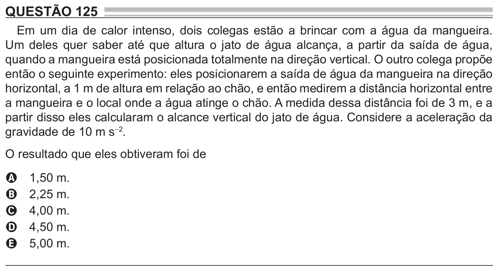

Texto extraído (pode conter ruído)

QUESTÃO 125  
Em um dia de calor intenso, dois colegas estão a brincar com a água da mangueira.  
Um deles quer saber até que altura o jato de água alcança, a partir da saída de água,  
quando a mangueira está posicionada totalmente na direção vertical. O outro colega propõe  
então o seguinte experimento: eles posicionarem a saída de água da mangueira na direção  
horizontal, a 1 m de altura em relação ao chão, e então medirem a distância horizontal entre  
a mangueira e o local onde a água atinge o chão. A medida dessa distância foi de 3 m, e a  
partir disso eles calcularam o alcance vertical do jato de água. Considere a aceleração da  
gravidade de 10 m s -2 .  
O resultado que eles obtiveram foi de  
1,50 m.  
A  
2,25 m.  
B  
4,00 m.  
C  
4,50 m.  
D  
5,00 m.  
E

