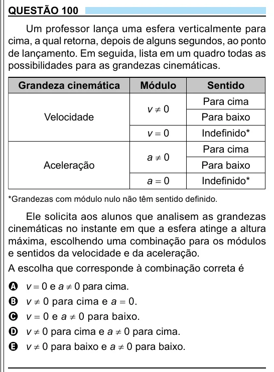

Texto extraído (pode conter ruído)

QUESTÃO 100  
Um professor lança uma esfera verticalmente para  
cima, a qual retorna, depois de alguns segundos, ao ponto  
de lançamento. Em seguida, lista em um quadro todas as  
possibilidades para as grandezas cinemáticas.  
Grandeza cinemática  
Módulo  
Sentido  
Para cima  
v ≠ 0  
Velocidade  
Para baixo  
v = 0  
Indefi nido*  
Para cima  
a ≠ 0  
Aceleração  
Para baixo  
a = 0  
Indefi nido*  
*Grandezas com módulo nulo não têm sentido definido.  
Ele solicita aos alunos que analisem as grandezas  
cinemáticas no instante em que a esfera atinge a altura  
máxima, escolhendo uma combinação para os módulos  
e sentidos da velocidade e da aceleração.  
A escolha que corresponde à combinação correta é  
v = 0 e a ≠ 0 para cima.  
A  
v ≠ 0 para cima e a = 0.  
B  
v = 0 e a ≠ 0 para baixo.  
C  
D  
v ≠ 0 para cima e a ≠ 0 para cima.  
v ≠ 0 para baixo e a ≠ 0 para baixo.  
E  
3

